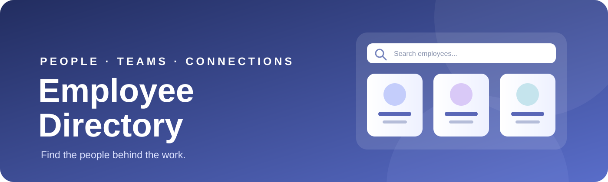
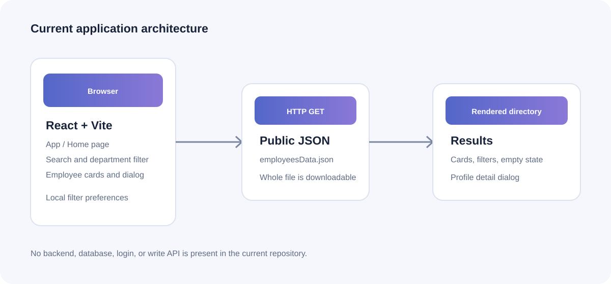
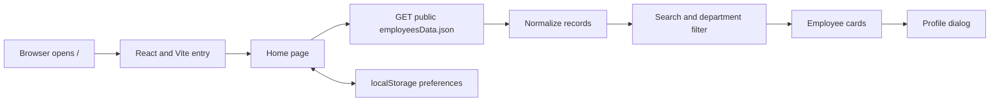
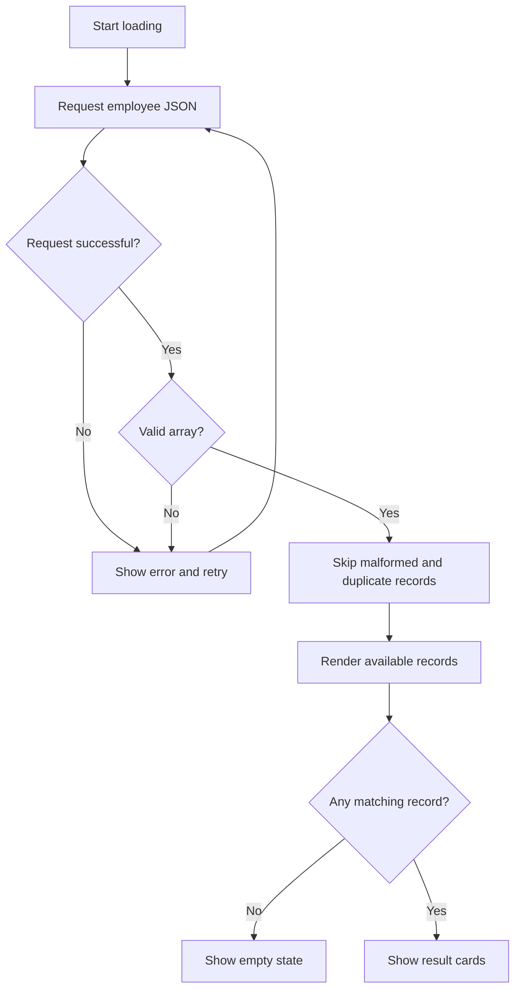
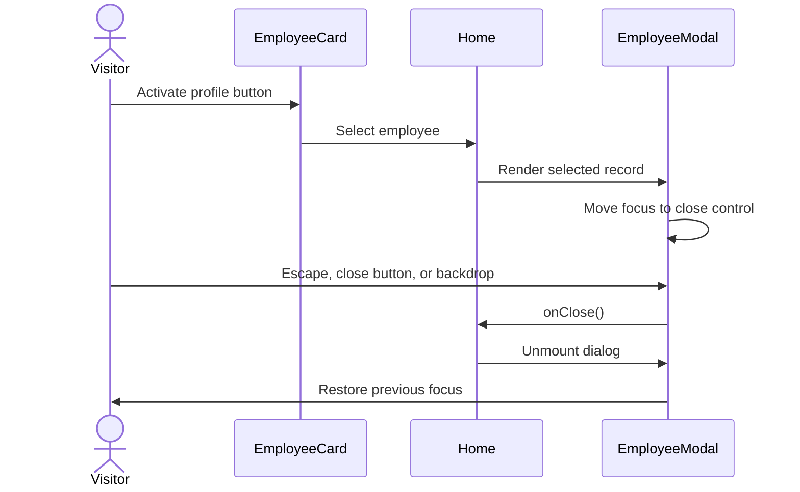

<div align="center">
  
  <h1>👥 Employee Directory</h1>
  <p><strong>A responsive React directory for browsing, searching, and exploring sample employee profiles.</strong></p>
  <p>
    
    
    
    
    <a href="https://github.com/Brajesh31/codersh_task/actions/workflows/ci.yml"></a>
  </p>
  <p><a href="#-quick-start">Quick start</a> · <a href="docs/README.md">Documentation</a> · <a href="CONTRIBUTING.md">Contributing</a> · <a href="SECURITY.md">Security</a></p>
</div>

---

## 📑 Contents
- [Overview](#-overview)
- [Problem and solution](#-problem-and-solution)
- [Features](#-features)
- [Technology stack](#-technology-stack)
- [Architecture and workflows](#-architecture-and-workflows)
- [Quick start](#-quick-start)
- [Commands](#-commands)
- [Data contract and privacy](#-data-contract-and-privacy)
- [Project structure](#-project-structure)
- [Accessibility and quality](#-accessibility-and-quality)
- [Deployment](#-deployment)
- [Current boundaries](#-current-boundaries)
- [Roadmap](#-roadmap)
- [Documentation](#-documentation)
- [Contributing and license](#-contributing-and-license)

## 🌟 Overview
Employee Directory is a single-page React application built with Vite. It loads a JSON dataset served from the site's public assets, displays employee summary cards, supports text search and department filtering, and opens an employee profile dialog. Search and department preferences are saved in the current browser's local storage.

The project is intentionally lightweight. It demonstrates client-side data loading, normalization, filtering, component composition, responsive presentation, and accessible interaction patterns. It is not an enterprise HR platform and should not be used to store or expose confidential workforce information.

## 🎯 Problem and solution
A small team directory can become difficult to browse when people are represented only by a flat list. This project offers a compact visual index with simple filtering and profile inspection. It keeps the initial architecture understandable: one React route, a public JSON data source, and focused UI components.

### Project objectives
1. Make a small employee dataset easy to scan.
2. Support quick lookups by employee name or email.
3. Narrow results by department.
4. Provide a focused profile view without leaving the directory.
5. Keep installation and local development simple.
6. Make the data exposure and prototype limitations explicit.

## ✨ Features
| Capability | Current behavior |
| --- | --- |
| 📦 Static data loading | Fetches `public/employeesData.json` using Axios |
| 🧹 Record normalization | Skips malformed records and duplicate IDs; fills safe optional defaults |
| 🔎 Search | Case-insensitive name and email matching |
| 🧭 Department filter | Exact department match using the supported selector values |
| 🪪 Employee cards | Responsive cards with photo or initials fallback |
| 🪟 Profile dialog | Shows employee details and supports close button, backdrop, and Escape |
| ⌨️ Keyboard interaction | Cards are semantic buttons; dialog provides a basic focus loop and restores focus |
| 💾 Local preferences | Saves search and department selections in browser localStorage |
| ♻️ Loading recovery | Loading, empty, error, and retry states |
| 📱 Responsive UI | Flexible card grid and narrow-screen filter/dialog layouts |

## 🧰 Technology stack
- **React 19** for the component-based interface.
- **Vite 6** for local development and production bundling.
- **React Router 7** for the current root route.
- **Axios** for retrieving the static JSON asset.
- **CSS** for responsive layout, interaction states, and motion preferences.
- **Node.js built-in test runner** for data helper tests.
- **ESLint 9** for static JavaScript and JSX checks.

## 🏛️ Architecture and workflows

### High-level architecture


The current runtime has no application server. The browser downloads the static employee JSON, normalizes it, applies search and filtering in memory, then renders cards and the selected profile dialog.



### Data loading and error handling


### Profile dialog interaction


## 🚀 Quick start

### Requirements
- Node.js 22 or newer is the documented CI runtime.
- npm (the lockfile is committed).
- A modern browser with JavaScript enabled.

### Install and run
```bash
git clone https://github.com/Brajesh31/codersh_task.git
cd codersh_task
npm ci
npm run dev
```

Open the local URL printed by Vite, usually `http://localhost:5173`.

### Production build
```bash
npm run lint
npm test
npm run build
npm run preview
```

Vite writes the static production bundle to `dist/`. The preview command is for local verification, not a production server.

## 🧪 Commands
| Command | Purpose |
| --- | --- |
| `npm ci` | Install exactly the versions in the lockfile |
| `npm run dev` | Start Vite's development server |
| `npm run lint` | Run ESLint against project JavaScript and JSX |
| `npm test` | Run Node's built-in unit tests |
| `npm run build` | Generate the production bundle in `dist/` |
| `npm run preview` | Preview the production bundle locally |

## 🗃️ Data contract and privacy
The source file is `public/employeesData.json`. A record requires a unique `id`, string `name`, string `email`, and string `department`. `photo` and `contact` are optional. The UI can display a `salary` field when supplied, but this field is not required for directory operation.

**Critical privacy boundary:** every file in Vite's `public/` directory is copied to the static output and can be downloaded by any visitor. Client-side filters and hidden UI elements are not access controls. Do not place confidential names, email addresses, phone numbers, compensation, or other personal employee information in this dataset. Use synthetic or expressly authorized records only. The application has no sign-in, authorization, database, or private API.

Search and department preferences are kept in localStorage on the current browser/device. The employee dataset is not written to browser storage by the application. See [Privacy and security](docs/privacy-security.md) before deployment.

## 🗂️ Project structure
```text
codersh_task/
├── .github/
│   ├── ISSUE_TEMPLATE/
│   └── workflows/
├── docs/
│   ├── assets/
│   ├── decision-records/
│   └── templates/
├── public/
│   └── employeesData.json
├── scripts/
├── src/
│   ├── lib/
│   └── Views/
│       ├── Components/
│       ├── CSS/
│       └── Pages/
├── tests/
├── README.md
├── CHANGELOG.md
├── CONTRIBUTING.md
├── LICENSE
├── package.json
└── vite.config.js
```

See [Project structure](docs/project-structure.md) for the purpose of the important files and folders.

## ♿ Accessibility and quality
The UI uses labelled search/filter controls, semantic employee-card buttons, live result messaging, reduced-motion styling, and a labelled modal dialog. The dialog supports Escape, a basic Tab focus loop, initial focus, and restoration to the previous element. These are implementation details, not a certified accessibility result.

Automated tests cover data normalization and filtering. CI runs lint, tests, and a production build. Manual keyboard and assistive-technology checks are still recommended. See [Accessibility guidance](docs/accessibility-guidelines.md) and [Testing](docs/testing.md).

## 🚢 Deployment
Deploy the generated `dist/` directory to any static host that supports SPA fallback to `index.html`. The default base path is root; configure Vite's `base` setting when publishing under a subpath. Ensure that `employeesData.json` is published alongside the built assets. Do not deploy confidential employee data. See [Deployment](docs/deployment.md) and [Hosting](docs/hosting.md).

## ⚠️ Current boundaries
- Data is a public static JSON file, not a protected store.
- There is no backend, database, authentication, authorization, editing, audit history, or employee administration.
- There is no server-side search or pagination.
- Department options are currently configured in the frontend.
- Employee photos may depend on third-party hosts and external usage rights.
- Browser localStorage can be unavailable or cleared by the user.
- Automated tests cover data helpers, not full browser workflows.
- No real UI screenshots are committed yet. Screenshots should be captured from a running build and must not contain personal data.

## 🧭 Roadmap
See [ROADMAP.md](ROADMAP.md). The highest-priority next steps are stronger browser-level interaction tests, a data-driven department list, a verified screenshot set, and a deliberate privacy-safe dataset. A protected backend is a separate architectural project, not a small extension to this static demo.

## 📚 Documentation
| Guide | What it covers |
| --- | --- |
| [Documentation hub](docs/README.md) | All project guides and references |
| [Product overview](docs/product-overview.md) | Purpose, scope, and core workflows |
| [Architecture](docs/architecture.md) | Current application boundaries and data flow |
| [Data contract](docs/data-contract.md) | Record schema and normalization |
| [Development](docs/development.md) | Local setup and code changes |
| [UI/UX guidelines](docs/ui-ux-guidelines.md) | Layout, controls, typography, and visual tokens |
| [Security](docs/security.md) | Threats and practical safeguards |
| [Accessibility](docs/accessibility.md) | Keyboard and assistive-technology behavior |
| [Testing strategy](docs/test-strategy.md) | Automated and manual verification |
| [Deployment](docs/deployment.md) | Static hosting and SPA configuration |
| [Privacy](docs/privacy.md) | Data exposure, local storage, and retention |
| [Known issues](docs/known-issues.md) | Confirmed limitations and technical debt |
| [Templates](docs/templates/README.md) | Reusable engineering templates |

## 🤝 Contributing and license
Read [CONTRIBUTING.md](CONTRIBUTING.md), follow the [Code of Conduct](CODE_OF_CONDUCT.md), and use the issue templates for reproducible reports. Security issues should be reported privately using [SECURITY.md](SECURITY.md).

The MIT grant in [LICENSE](LICENSE) applies to the original application source and documentation authored by Brajesh Kumar. It does not automatically cover the sample employee records, external images, Vite starter artwork, or third-party dependencies. Verify those rights separately.
