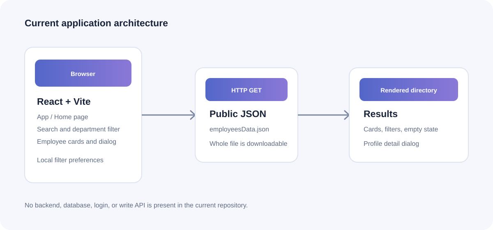

# 🏛️ Architecture

## Overview
The repository is a client-side React application built with Vite. The App component renders the single directory page at `/` without a routing library and requests the static employee dataset from the Vite public directory. Record normalization and filtering are pure functions in `src/lib/employeeData.js`.

```text
Browser
  -> index.html / src/main.jsx (entry and StrictMode)
  -> src/App.jsx (root page composition)
  -> src/Views/Pages/Home.jsx (request, controls, states, selection)
       -> Browser Fetch API GET ${import.meta.env.BASE_URL}employeesData.json
       -> src/lib/employeeData.js (normalize + filter)
       -> EmployeeCard list
       -> EmployeeModal for selected record
       -> localStorage for search and department preferences
  -> public/employeesData.json (public static sample)
```

## Components and responsibilities
| Path | Responsibility |
| --- | --- |
| `src/main.jsx` | Mounts React under StrictMode |
| `src/App.jsx` | Renders the Home directory page |
| `src/Views/Pages/Home.jsx` | Fetches data, owns page state, filters, and dialog selection |
| `src/lib/employeeData.js` | Normalizes input and filters valid rows |
| `src/Views/Components/EmployeeCard.jsx` | Semantic employee summary button |
| `src/Views/Components/EmployeeModal.jsx` | Labelled profile dialog and focus lifecycle |
| `src/Views/CSS/` | Page, card, and dialog styles |
| `public/employeesData.json` | Public sample records |
| `tests/employeeData.test.js` | Pure data-helper unit tests |

## Data flow
1. Home initializes filter state from localStorage.
2. Home fetches the public data using the browser Fetch API and Vite's base URL.
3. `normalizeEmployees` rejects non-array payloads, skips malformed records and duplicate IDs, and fills optional defaults.
4. `filterEmployees` performs case-insensitive name/email search and exact department matching.
5. React renders cards and a live result count.
6. Selecting a card displays the profile dialog.

## Dialog interaction
The modal moves focus to its close button, listens for Escape, provides a basic Tab focus loop, locks body scrolling, and restores focus on unmount. Browser/screen-reader testing remains necessary.

## Privacy and trust boundaries
The entire JSON file is public. The sample now uses synthetic names, `@example.invalid` email addresses, no phone/salary fields, and no remote portrait URLs. Any additional field placed in the public file becomes visible to visitors. There is no backend, database, authentication, authorization, or protected API.

## Architecture diagram


See [system design](system-design.md), [data flow](data-flow.md), and [security architecture](security-architecture.md).
