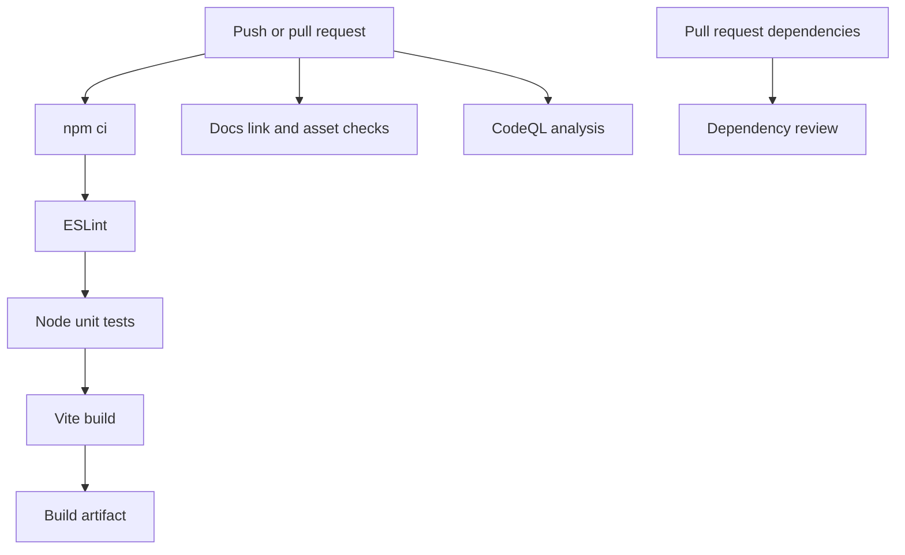

# 🔄 CI/CD

## Current automation
The repository has a CI workflow for locked npm installation, lint, Node unit tests, and Vite production build. A documentation validation workflow checks local Markdown links and repository JSON/SVG files. CodeQL analyzes JavaScript source, dependency review evaluates pull request dependency changes, and Dependabot checks npm and GitHub Actions updates weekly.

## Current release behavior
The workflows do not publish a production deployment or create a tagged release. The build artifact is retained temporarily for inspection. Hosting deployment remains a manual/provider-specific operation.

## Pipeline flow

## Pipeline safety
Use read-only permissions for validation jobs. Grant write access only to a job that truly publishes or modifies repository content. Review action versions and do not echo tokens in workflow logs.
