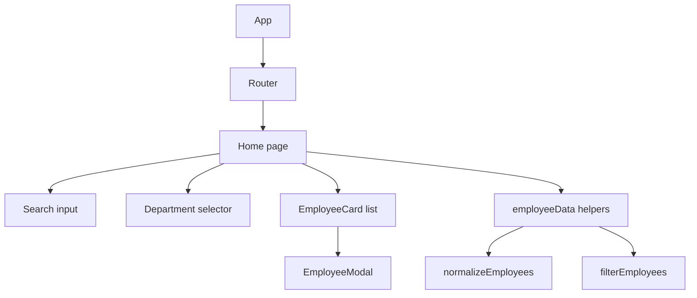

# 🧩 Component architecture

## Responsibilities
| Component/module | Responsibility | State ownership |
| --- | --- | --- |
| `App` | Root route and stylesheet import | None |
| `Home` | Fetch, loading/error state, filters, selection | Main page state |
| `EmployeeCard` | Render one selectable employee summary | None |
| `EmployeeModal` | Display selected profile and keyboard behavior | Focus refs/effect |
| `normalizeEmployees` | Validate records and normalize optional values | Pure function |
| `filterEmployees` | Apply search and department conditions | Pure function |

## Component contracts
EmployeeCard receives `data` and `onSelect`. EmployeeModal receives `employee` and `onClose`. Keep these contracts focused. Avoid moving application-wide state into individual cards.

## Extension guidance
If the directory grows, extract a dedicated filter toolbar, result-state component, or data hook only when that reduces complexity and creates a stable test boundary. Do not create a large abstraction hierarchy for a small one-page app.
