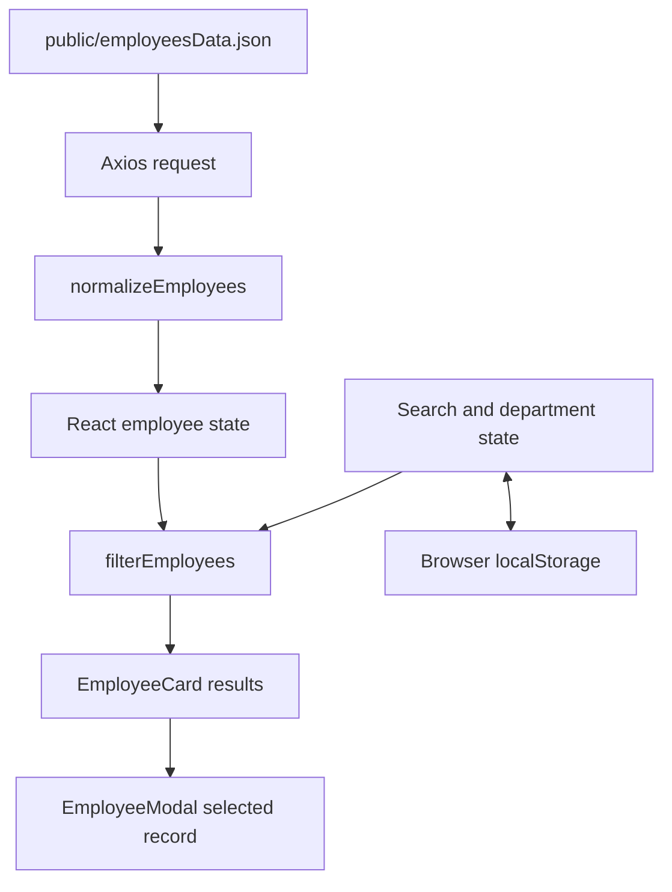

# 🔀 Data flow

## Source to screen
1. Static host serves `public/employeesData.json`.
2. Home requests it with Axios using Vite's configured base path.
3. The payload is passed to `normalizeEmployees`.
4. Valid normalized rows are stored in React state.
5. `filterEmployees` filters by search and department.
6. EmployeeCard renders each match.
7. EmployeeModal renders the selected record.

## Preference flow
Search and department selection update controlled React state. Effects persist those two strings in localStorage. On the next load, the initial state reads the values back. If browser storage is unavailable, the helpers return empty defaults or ignore the write.

## Mermaid data-flow view

There is no database read/write flow, no private API, no data synchronization across devices, and no server-side event pipeline.
