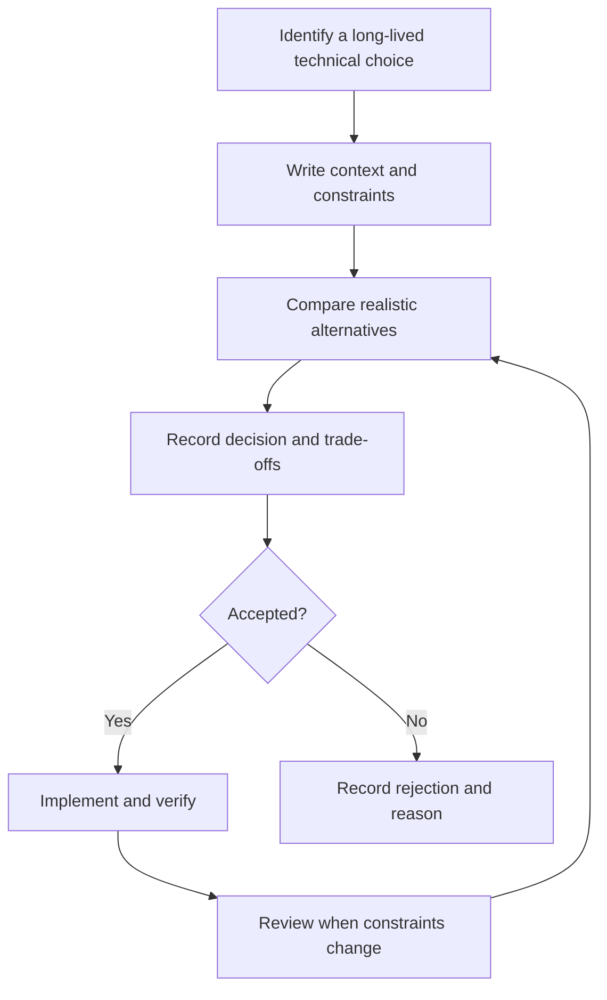

# 🗒️ Architecture and product decision log

This index records decisions that affect the shape, safety, or maintenance of the Employee Directory. A decision should be recorded when it creates a lasting constraint or trade-off, not for every small CSS or copy edit.

## 📚 Accepted decisions

| ID | Decision | Status | Supporting record |
| --- | --- | --- | --- |
| ADR 0001 | Keep a static JSON source for the small public demo | Accepted for current scope | [0001-static-json-data-source](decision-records/0001-static-json-data-source.md) |

## 🧭 Decisions currently reflected in the implementation

| Area | Current decision | Reason / consequence |
| --- | --- | --- |
| Application composition | One React screen, no router | The current product has one root page. A router should be added only when a second navigable view is implemented. |
| Data source | Public `public/employeesData.json` file | Easy to run without a server, but every field is downloadable. Use synthetic, public-safe data only. |
| Data validation | Pure normalization and filtering helpers | Keeps input rules testable without mounting React. It is not server-side validation or access control. |
| Browser persistence | Store only search and department preferences in localStorage | Convenience state is restored locally; employee records are not persisted by the UI. |
| UI tests | Node's built-in test runner for pure helpers | No extra test framework is needed for deterministic utility functions. Full UI testing remains a separate decision. |
| Styling | Project-owned CSS | Avoids adding a UI framework for a small set of screens and preserves control over responsive behavior. |
| Hosting assumption | Static site output in `dist/` | Any chosen host must serve the JSON asset and provide root-route fallback. No production provider is selected. |

## 📝 When to add a decision record

Create a new ADR when a change affects:
- Public/private data boundaries or the employee record schema.
- A new backend, database, API, authentication, or authorization model.
- A router, design system, UI library, or state-management framework.
- Deployment provider, build pipeline, secret management, or monitoring service.
- Dependency choices that materially affect compatibility, maintenance, or supply-chain risk.
- A decision that is difficult or expensive to reverse.

## 🔄 Decision lifecycle

## 📋 Record states

- **Proposed:** being considered, not a commitment.
- **Accepted:** chosen and reflected in implementation or approved plan.
- **Superseded:** replaced by a later decision. Keep the old record for history.
- **Rejected:** considered and not selected, with the reason preserved.

A decision record is not proof that implementation has shipped. Link evidence to the relevant commit and tests. Avoid recording personal employee details, secrets, or confidential incident material in this public repository.
