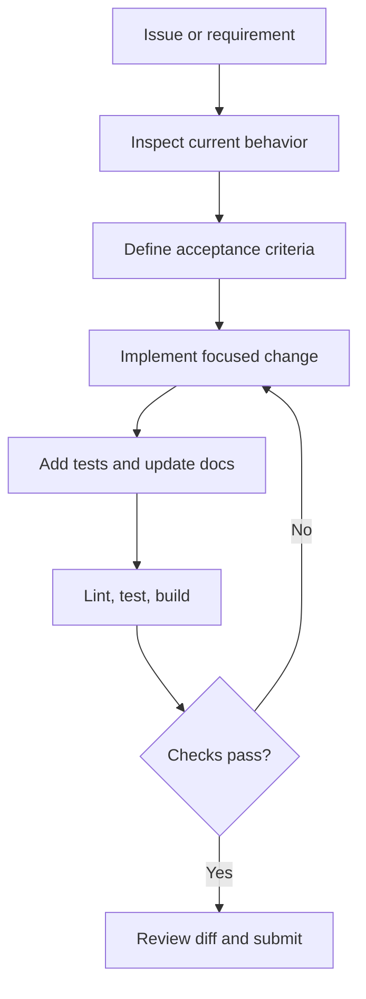

# 🔁 Development workflow

1. **Understand the change:** read the relevant documentation and inspect the current component/helper.
2. **Define behavior:** write acceptance criteria for normal, empty, and error cases.
3. **Consider exposure:** identify any data field added to the public JSON or UI.
4. **Implement a focused change:** keep pure logic testable and UI components narrow.
5. **Add or update tests:** especially for normalization, search semantics, and edge cases.
6. **Update documentation:** adjust architecture, data contract, UI behavior, and known issues as needed.
7. **Run local checks:** install, lint, test, and build.
8. **Review the complete diff:** check generated files, secrets, external assets, and privacy.
9. **Submit evidence:** explain what changed and which checks ran.

