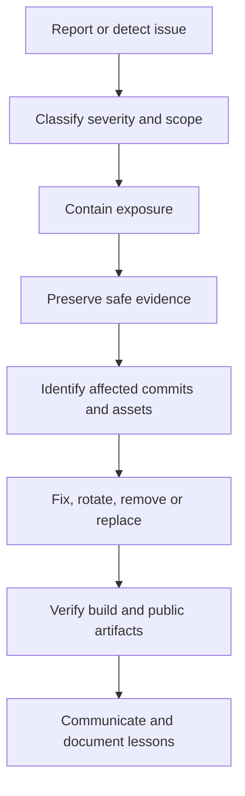

# 🚨 Incident response

This is a lightweight response guide for repository maintainers. It does not replace an organization's formal incident plan.

## Trigger examples
- Confidential employee data was committed or published.
- A credential or repository token was exposed.
- A dependency or workflow compromise is suspected.
- A serious vulnerability affects the deployed static site.

## Response sequence

## Data exposure
Remove unsafe data from the published asset, redeploy, and consider Git history cleanup where necessary. A new commit alone does not remove the old value from history, forks, or caches. Coordinate history rewriting carefully and rotate any exposed credentials.

## Communications
Use private channels for sensitive details. Do not paste affected employee records into issues or incident logs. Record what happened, impact, containment, corrective action, and follow-up owner.
