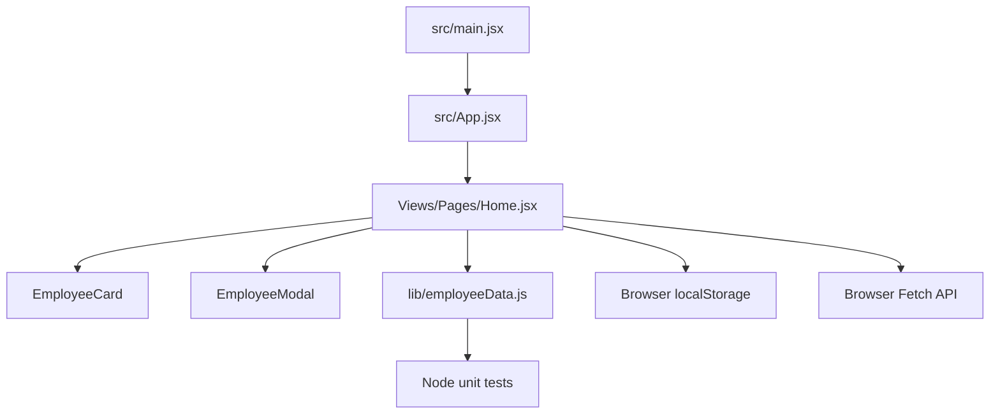

# 🧱 Module documentation

## 1. Source modules and contracts

| Path | Role | Inputs / outputs |
| --- | --- | --- |
| `src/main.jsx` | React entry point | Mounts App into `#root` under StrictMode |
| `src/App.jsx` | Root composition | Renders the Home directory screen; no routing library |
| `src/Views/Pages/Home.jsx` | Directory page coordinator | Owns request state, filters, result list, status views, and selected employee |
| `src/Views/Components/EmployeeCard.jsx` | Result card | Receives `data` and `onSelect`; renders a semantic button |
| `src/Views/Components/EmployeeModal.jsx` | Profile dialog | Receives `employee` and `onClose`; owns dialog keyboard/focus lifecycle |
| `src/lib/employeeData.js` | Pure data helpers | Exports `normalizeEmployees(payload)` and `filterEmployees(rows, query, department)` |
| `src/Views/CSS/Home.css` | Page styles | Directory header, controls, loading/error/empty states, footer |
| `src/Views/CSS/EmployeeCard.css` | Card styles | Card layout, image fallback, interaction feedback |
| `src/Views/CSS/EmployeeModal.css` | Dialog styles | Backdrop, dialog surface, details, responsive layout |
| `src/index.css` | Global styles | Base typography, focus visibility, reduced motion, screen-reader utility |
| `src/App.css` | Root-level styles | Root sizing and application background |
| `tests/employeeData.test.js` | Unit tests | Exercises normalization and filtering under Node |

## 2. Dependency direction

- The data helper must remain independent of React and browser globals.
- Presentational components receive values and callbacks through props.
- The page owns selection state; the dialog must not become a second owner of which employee is selected.
- The dialog owns its DOM lifecycle concerns, such as focus handling and body scroll locking.
- Styles are split by UI responsibility. Keep global resets and focus behavior in `index.css`.

## 3. Data helper contract

### `normalizeEmployees(payload)`

Requires an array. It skips null/non-object rows, invalid or duplicate identifiers, and rows whose name, email, or department is blank. Accepted text fields are trimmed. Photo values are limited to HTTPS or root-relative paths. Contact values become strings when supplied.

### `filterEmployees(employees, searchTerm, department)`

Search is case-insensitive and checks name/email. A non-empty department value is matched exactly. Blank inputs do not constrain results.

## 4. State ownership

| State | Owner | Persistence |
| --- | --- | --- |
| Raw normalized employee rows | Home | In memory only |
| Search value | Home | localStorage key `savedSearchTerm` |
| Department filter | Home | localStorage key `savedDepartment` |
| Selected employee | Home | In memory only |
| Loading / error status | Home | In memory only |
| Dialog focus references | EmployeeModal | DOM lifecycle only |

## 5. Change coordination

When a data field or user flow changes, update the relevant helper, component, unit tests, sample fixture, data contract, architecture/flow diagram, and checklist evidence together. Do not make a field required solely because one view happens to display it.
