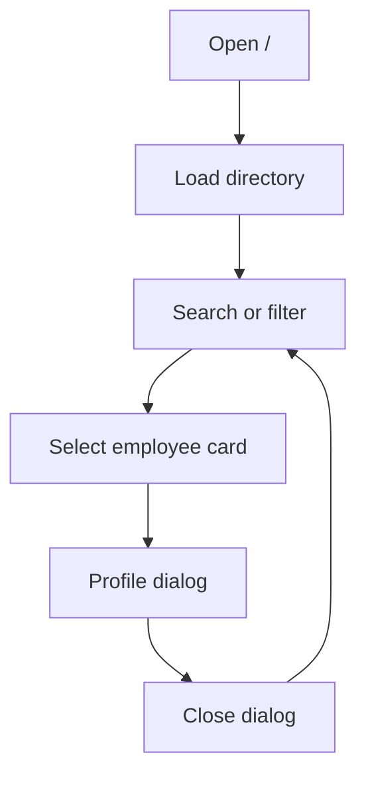

# 🧭 Navigation and page structure

## 1. Current page map

The application currently presents one directory screen at the root URL. It does not have a navigation menu or a routing library.

| Path | View | Purpose |
| --- | --- | --- |
| `/` | Employee Directory | Browse, search, and filter the sample employee list |

The employee profile is an in-page dialog state, not a separate route. Documentation links live in the repository README and do not appear in the application navigation.

## 2. Current user flow

## 3. Navigation behavior

- The page is available at the root path.
- Search and department selection update the current result list without changing the URL.
- Selecting an employee opens a dialog without changing the URL.
- Closing the dialog returns the visitor to the same filter state.
- Search and department preferences are stored locally; selected profile state is not persisted.

## 4. Future route additions

Add a route only when a real second screen exists. For each route, document:
- URL and purpose.
- Page title and heading structure.
- How users arrive and return.
- Deep-link and refresh behavior.
- Loading, empty, and error states.
- Accessibility and keyboard expectations.
- Whether access control is required.

A future router requires static-host fallback behavior and tests for direct URL loading. Do not add a navigation library solely to make a one-page app appear larger.
