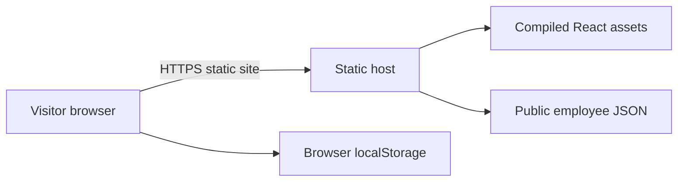

# 🛡️ Security architecture

## Current architecture

All visitors receive the same static application and can request the JSON asset directly. The application does not distinguish identities or roles.

## Missing security boundaries
- No authentication provider or credential validation.
- No authorization check for employee records.
- No server-side data validation.
- No database permissions or encryption-at-rest configuration.
- No audit logging or privileged admin endpoint.
- No private API token or server secret.

## Consequence
A static employee directory must contain only public-safe data. Hiding fields in React, filtering records in the browser, or adding a client-side route guard cannot protect sensitive data.

## Future protected design
If private data is required, the browser should call a server API over HTTPS. The server should authenticate the user, authorize each operation, validate and minimize returned fields, log relevant privileged actions, and read from protected storage. That future system needs a separate architecture review.
