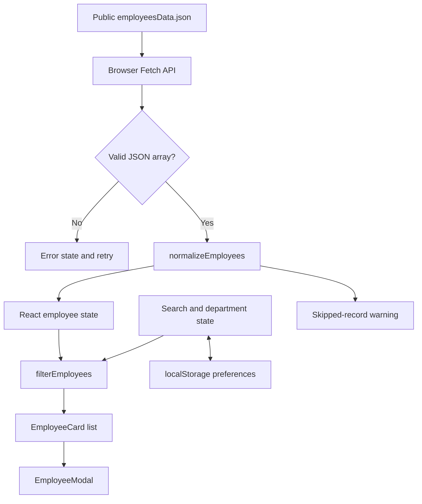

# 💡 Solution overview

## 🎯 What is implemented

The application is a small React interface for browsing a fixed, public sample directory. It does not connect to an HR system or private employee database. The current design is intentionally lightweight: one page, a static JSON file, local filtering, and a focused profile dialog.

## 🔄 Request and rendering flow

1. Vite serves the document shell, compiled React assets, and the public sample JSON.
2. The Home page requests the JSON through the browser Fetch API using Vite's configured base path.
3. `normalizeEmployees` requires an array, validates each record, skips malformed or duplicate entries, trims required strings, and normalizes optional values.
4. `filterEmployees` applies case-insensitive name/email search and exact department matching.
5. The page renders semantic EmployeeCard buttons and a live count.
6. Selecting a card opens EmployeeModal, which handles Escape, backdrop close, focus placement, and focus restoration.
7. Search and department preferences are stored locally, but employee records are not saved to browser storage.

## 🧩 Responsibilities

| Module | Responsibility |
| --- | --- |
| `src/Views/Pages/Home.jsx` | Request lifecycle, page state, filters, status views, profile selection |
| `src/lib/employeeData.js` | Pure normalization and filtering logic |
| `EmployeeCard.jsx` | Keyboard-operable result card |
| `EmployeeModal.jsx` | Selected profile dialog and focus lifecycle |
| `public/employeesData.json` | Synthetic public demonstration records |
| `tests/employeeData.test.js` | Unit tests for the pure data contract |

## ⚠️ Failure behavior

- Network or non-success HTTP response: display an error and retry action.
- Invalid top-level payload: normalization throws and the page shows the error state.
- Invalid individual rows: skip them and show a non-blocking warning.
- Missing image: show an initials fallback rather than failing the record.
- Browser storage unavailable: the directory remains usable, but preferences may not persist.

## 🔐 Privacy boundary

Every field under `public/` is downloadable by visitors. The demo dataset uses synthetic names and reserved `@example.invalid` email values, and omits phone, salary, and remote profile-photo values. Client-side filtering is not access control.

## 🚫 Deliberate non-goals

The implementation does not include a backend, database, login page, sessions, authorization, employee editing, payroll, attendance, or an HR integration. Those would require a separate architecture, threat model, data model, and delivery plan.
