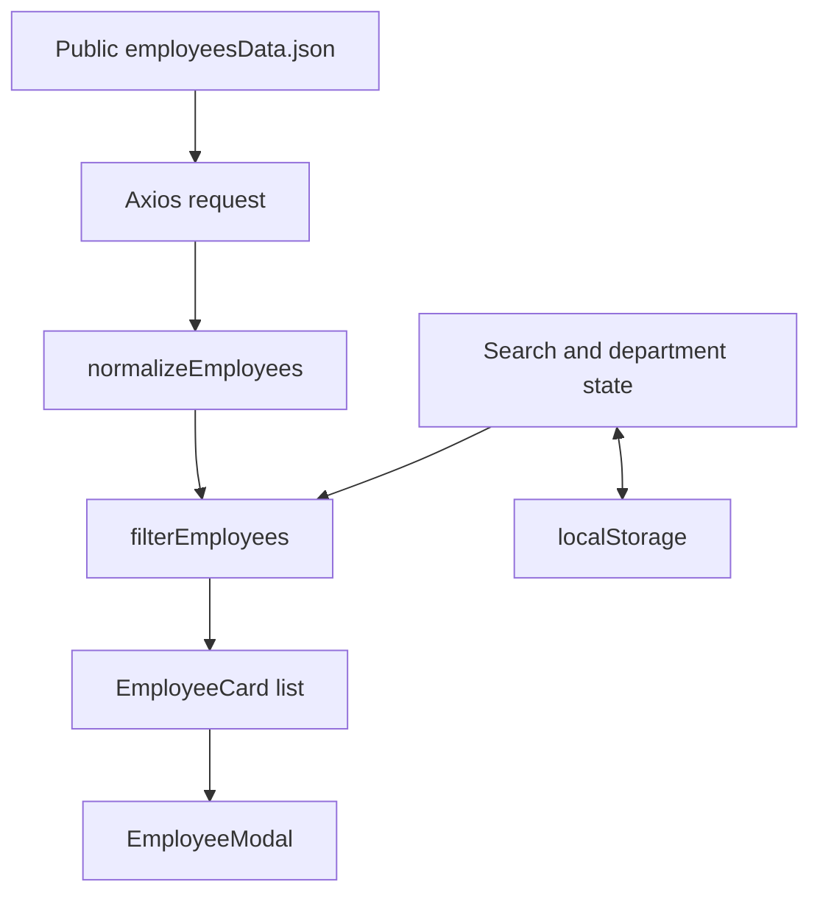

# 💡 Solution overview

The application uses a small set of React components around a static JSON data source.

1. Vite serves the application and public asset.
2. The Home page fetches the JSON with Axios.
3. The normalization helper checks the array and each record's required fields, then skips duplicate identifiers.
4. The filtering helper applies a case-insensitive name/email query and exact department selection.
5. EmployeeCard renders a semantic button for each result.
6. EmployeeModal renders the selected record in a labelled dialog.
7. Search and department preferences are saved in localStorage.

The design deliberately does not add a backend, database, login page, or employee write flow because none is present in the current requirements or code.
