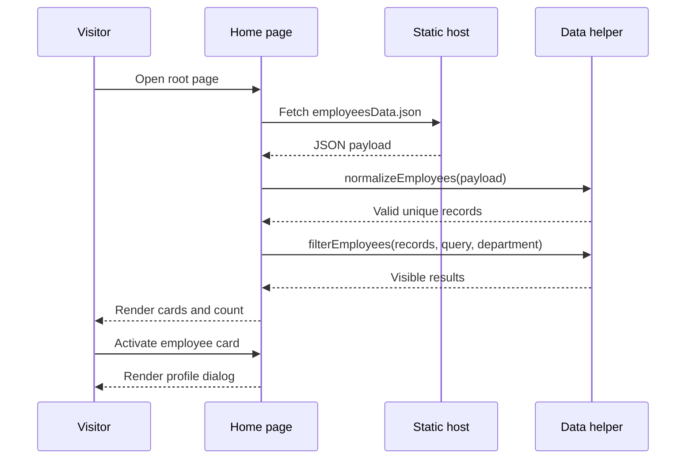

# 🏛️ System design

## 1. Design summary

The application is a browser-only single-page interface. Vite serves the document shell, compiled assets, and one public JSON file. React owns transient interface state. Browser localStorage holds two optional presentation preferences.

There is no router package in the current dependency tree. `src/App.jsx` composes the Home directory screen directly at `/`.

## 2. Logical components

1. **Entry:** `index.html` loads `src/main.jsx`.
2. **Root composition:** `src/App.jsx` renders the Home page.
3. **Page coordinator:** `Home.jsx` fetches and normalizes data, manages filters and selected profile, and renders status states.
4. **Data helper:** `src/lib/employeeData.js` validates individual records and computes filtered results.
5. **View components:** EmployeeCard and EmployeeModal render the list and selected profile.
6. **Data asset:** `public/employeesData.json` is copied to the static build and delivered publicly.
7. **Browser storage:** localStorage stores only the search string and department selection.

## 3. Runtime sequence

## 4. Data and state boundaries

- The static host stores the sample file; it does not provide application data authorization.
- React component state owns employee rows, filters, request status, and selected employee.
- localStorage is controlled by the visitor and stores only display preferences.
- The visitor can request the full JSON file independently of the UI.
- The app does not persist profile data or perform employee writes.

## 5. Trust boundaries

The public static host is not a private data service. Browser state is controlled by the visitor. There is no server-side session, database, authentication, authorization, or protected API. Every data field in the JSON file should be considered public.

## 6. Design implications

The current approach is suitable for a small demonstration dataset. If confidential employee records or editing are needed, the application must move data behind a server-side access-control boundary, introduce an authorization model, and define audit, retention, deletion, backup, and recovery practices. A database or login screen alone would not be enough.
