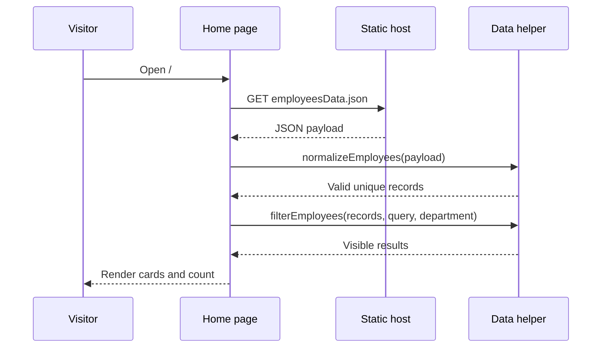

# 🏛️ System design

## Design summary
The application is a browser-only single-page interface. Vite serves compiled assets and a public JSON file. React owns transient UI state; the browser's localStorage holds two optional presentation preferences.

## Logical components
1. **Entry:** `index.html` loads `src/main.jsx`.
2. **Router:** `src/App.jsx` declares the root route.
3. **Page coordinator:** `Home.jsx` fetches data and coordinates controls and selection.
4. **Data helper:** `src/lib/employeeData.js` normalizes records and computes filtered results.
5. **View components:** `EmployeeCard` and `EmployeeModal` render the list and selected profile.
6. **Data asset:** `public/employeesData.json` is published as a static file.

## Runtime sequence

## Trust boundaries
The public static host is not a trusted data service. The visitor can download the full source JSON. Browser state is controlled by the visitor. There is no private server boundary, session, database, or authorization layer.

## Design implications
The design is appropriate for a small demonstration dataset. If the project needs confidential employee records, it must move those records behind a server-side access-control boundary and use the frontend only as a client.
