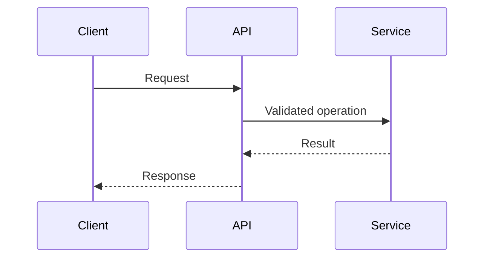

# 🔌 API reference template

> Use only when the project has a real API. Do not create fictional endpoints.

## API overview
Purpose, base URL, owner, versioning, availability, and documentation date.

## Authentication and authorization
Describe the actual mechanism, token/session requirements, scopes/roles, and denied-request behavior. Never include real secrets.

## Endpoint catalogue
| Method | Path | Purpose | Auth required |
| --- | --- | --- | --- |
| GET | | | |

## Endpoint detail
### METHOD /path
- Purpose:
- Path/query parameters:
- Headers:
- Request body schema:
- Success response:
- Error responses:
- Rate limits:
- Idempotency:
- Pagination:

## Data models
Document field names, types, required/optional status, validation, privacy classification, and examples using synthetic values.

## Error contract
| Code | Meaning | Client action |
| --- | --- | --- |

## Sequence diagram

## Security and lifecycle
CORS, authorization, retention, deprecation, monitoring, and change policy.
