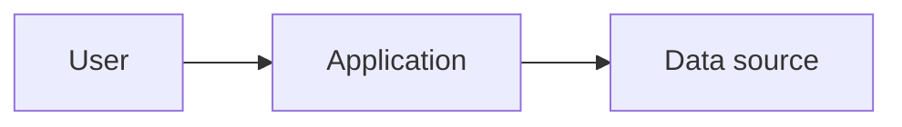

# 🏛️ Architecture document

## Purpose and status
Describe the system boundary, intended audience, owner, and review date.

## Context
Summarize the problem, deployment environment, users, data classification, and external dependencies.

## System context diagram

## Containers and components
For each runtime or component, document responsibility, technology, owner, and trust boundary.

## Data flows
Describe source, processing, storage, destination, validation, and deletion. Identify whether assets are public or protected.

## Security model
Document identity, authentication, authorization, secrets, encryption, logging, and known controls. Mark absent controls honestly.

## Operational model
Build, deploy, monitor, backup, rollback, and support.

## Quality attributes
Performance, accessibility, compatibility, maintainability, availability, and privacy.

## Risks, alternatives, and decisions
Link ADRs and record unresolved questions.
