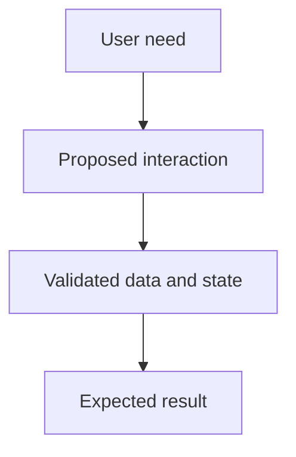

# 📝 Technical and product change request

> Use for a change with meaningful user, architecture, security, or operational impact. Routine copy or formatting fixes may use a normal issue instead.

## 1. Request metadata

| Field | Value |
| --- | --- |
| Change ID | |
| Title | |
| Requester | |
| Date | |
| Proposed owner | |
| Status | Proposed / Accepted / Rejected / Deferred / Implemented |
| Related issue / ADR | |

## 2. Problem and evidence

What problem exists today? Who experiences it? Link reproduction steps, user feedback, support issue, audit finding, or technical evidence. Avoid proposing a solution before explaining the need.

## 3. Desired outcome and scope

**Outcome:**

**Included:**
- 

**Explicitly excluded:**
- 

## 4. Proposed implementation

List affected UI components, utility modules, data fields, styles, documentation, workflows, external services, and configuration. State whether a migration or compatibility transition is required.

## 5. User journey and data flow

Replace the generic nodes with the actual user flow before approval.

## 6. Alternatives considered

| Option | Benefit | Cost / limitation | Reason selected or rejected |
| --- | --- | --- | --- |
| | | | |

## 7. Security, privacy, and legal impact

- [ ] Does the change expose any new employee fields?
- [ ] Does it introduce storage, analytics, cookies, external requests, or tracking?
- [ ] Does it add credentials or public client configuration?
- [ ] Does it introduce an API, backend, database, authentication, or authorization?
- [ ] Are external images, fonts, and dependencies licensed and reviewed?
- [ ] Are retention, deletion, and backup requirements affected?

For this static frontend, adding a field to public JSON makes that field downloadable. Hidden UI does not create confidentiality.

## 8. Accessibility and usability

Describe keyboard activation, focus behavior, screen-reader names/announcements, contrast, zoom/reflow, touch targets, and reduced-motion impact.

## 9. Acceptance criteria

- [ ] 
- [ ] 
- [ ] 

Criteria must be measurable and tied to visible behavior or test evidence.

## 10. Verification and rollout

Commands, unit tests, browser checks, manual review, deployment steps, monitoring, and rollback plan. Include owner and evidence location.

## 11. Risk and dependencies

| Risk | Impact | Mitigation | Owner |
| --- | --- | --- | --- |
| | | | |

## 12. Decision and outcome

**Decision:** Accepted / Rejected / Deferred

**Decision rationale:**

**Conditions:**

**Implementation commit / PR:**

**Verification result:**
