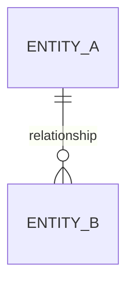

# 🗄️ Database schema template

> This is a future-use template. The current Employee Directory has no database.

## Database context
Engine/version, hosting, environments, owner, data classification, and purpose.

## Entity catalogue
| Entity/table | Purpose | Owner | Sensitivity |
| --- | --- | --- | --- |
| | | | |

## Schema
Document columns, types, defaults, nullability, primary keys, unique constraints, indexes, and foreign keys.

## Relationships

## Access model
Roles, permissions, least privilege, service identities, and administrative access.

## Data lifecycle
Creation, update, retention, archival, deletion, backup, restoration, and legal hold.

## Migration plan
Forward migration, rollback strategy, compatibility window, validation query, and owner.

## Security
Encryption, secrets, network boundary, audit events, monitoring, and incident response.
