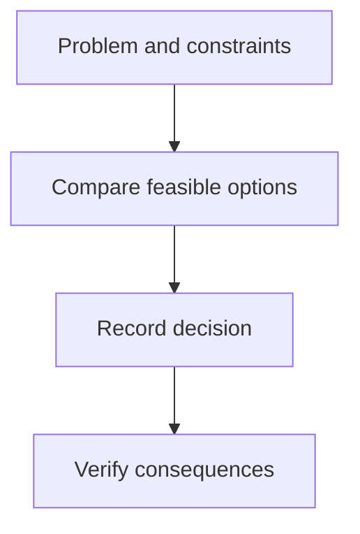

# 🧭 ADR NNNN: Decision title

- **Status:** Proposed | Accepted | Rejected | Superseded
- **Date:** YYYY-MM-DD
- **Decision owner:** Name/role
- **Related issue/PR:** Link, if available
- **Review date:** YYYY-MM-DD or Not scheduled

## 1. Context
Describe the user problem, technical constraint, security/privacy impact, scale, and reason a decision is needed. Separate observed facts from assumptions.

## 2. Decision drivers
| Driver | Priority | Evidence |
| --- | --- | --- |
| User value | High/Medium/Low | |
| Maintainability | High/Medium/Low | |
| Security/privacy | High/Medium/Low | |
| Delivery cost | High/Medium/Low | |

## 3. Options considered
Describe each real alternative and its trade-offs.

## 4. Decision
State the selected option and the reason it best satisfies the drivers.

## 5. Consequences
List positive consequences, negative consequences, new risks, and operational responsibilities.

## 6. Verification and revisit conditions
Define how the outcome will be verified and what future event should trigger reconsideration.

## 7. Diagram

