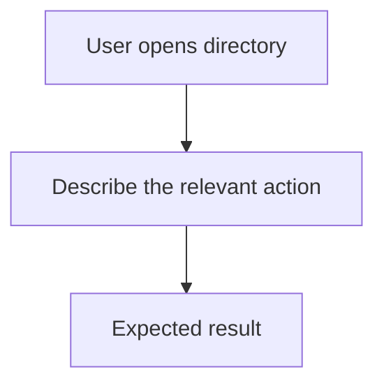

# ✨ Feature specification

## Summary
What is being proposed?

## User problem
Who experiences the problem, and what evidence shows it matters?

## Scope
### Included
- 

### Excluded
- 

## User flow

## Data and privacy
List the fields and data exposure implications. Do not propose putting confidential values in public assets.

## Accessibility
Keyboard, screen-reader, focus, contrast, and reduced-motion considerations.

## Acceptance criteria
- [ ] 
