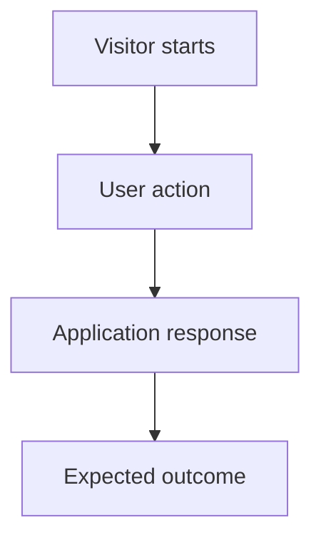

# ✨ Feature specification

## Document control
| Field | Value |
| --- | --- |
| Feature | |
| Status | Draft / Review / Approved / Implemented |
| Owner | |
| Date | |
| Related issue | |

## 1. Summary
Describe the proposed behavior in a short, testable statement.

## 2. Problem and evidence
Who experiences the problem? What current behavior is insufficient? Include user reports or observable evidence. Mark assumptions clearly.

## 3. User stories
- As a [visitor/maintainer], I want [capability], so that [outcome].

## 4. Scope
### Included
- 

### Excluded
- 

## 5. User journey

## 6. Functional requirements
| ID | Requirement | Priority | Acceptance evidence |
| --- | --- | --- | --- |
| FR-01 | | Must/Should/Could | |

## 7. Non-functional requirements
Cover performance, responsive behavior, reliability, maintainability, security, privacy, and accessibility. Do not claim a standard is met without evidence.

## 8. Data and privacy
List fields processed, source, ownership/authorization, public exposure, retention, deletion, and any external recipient. For this repository, any field in `public/` is downloadable.

## 9. Error and empty states
Describe malformed input, request failure, no matches, missing optional values, and retry/recovery behavior.

## 10. Test plan
List unit, component, browser, manual, and accessibility checks.

## 11. Rollout and rollback
Describe how the feature is released and reverted.

## 12. Risks, open questions, and approvals
Record unresolved questions and the people responsible for the decision.
