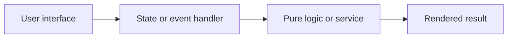

# 🏗️ Technical design

## Document control
| Field | Value |
| --- | --- |
| Change | |
| Author | |
| Status | Draft / Review / Accepted |
| Related issue/ADR | |

## Context and current behavior
Describe the existing module, current user flow, and constraints. Link to source paths.

## Proposed design
Explain the change, responsibilities, state ownership, interfaces, and important data transformations.

## Component and data flow

## Data contract
Document fields, types, required/optional rules, validation, sample synthetic payload, and migration implications.

## Error handling
Describe failure cases, safe user messaging, retry behavior, and diagnostic boundaries.

## Security and privacy
Identify trust boundaries, public/static data, credentials, external services, authorization, retention, and deletion implications.

## Accessibility and responsive behavior
Document labels, semantics, keyboard, focus, screen-reader announcements, contrast, zoom, and reduced motion.

## Performance and compatibility
Record expected cost, data size assumptions, browser/runtime constraints, and test method.

## Alternatives and trade-offs
Compare realistic alternatives and explain why they were not selected.

## Test strategy and acceptance criteria
List automated tests, manual checks, deployment verification, and rollback triggers.
