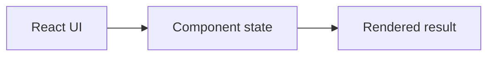

# 🏗️ Technical design

## Context and constraints

## Proposed approach

## Component and data flow

## Failure handling

## Security and privacy

## Accessibility

## Alternatives and trade-offs

## Rollout and rollback
