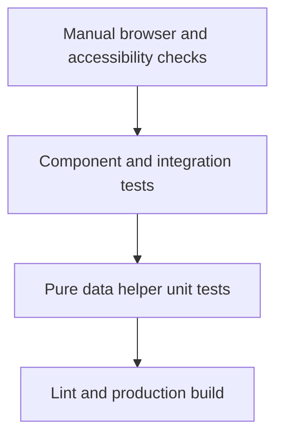

# 🧪 Test strategy

## Strategy
Use the cheapest test layer that can prove the expected behavior. Pure record validation and filtering are unit tested with Node's built-in runner. Lint catches source errors and the Vite build validates bundling. Manual browser checks cover loading, dialogs, keyboard interaction, and responsive rendering.

## Test pyramid

## Coverage priorities
- Array validation, required fields, optional defaults, duplicate IDs.
- Search trimming, case-insensitive name/email matching, exact department filtering.
- Request success, invalid payload, failure, cancellation, and retry.
- Modal close behavior, focus management, and accessible name.
- localStorage availability and preference restoration.
- Responsive and reduced-motion behavior.

## Current gap
There is no dedicated React component test or browser E2E framework. Unit tests do not prove the dialog works across real browsers. Add a browser harness when the project requires repeatable UI-level regression coverage.
