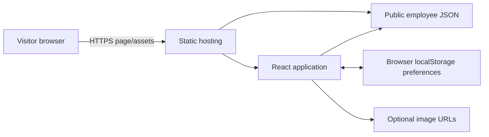
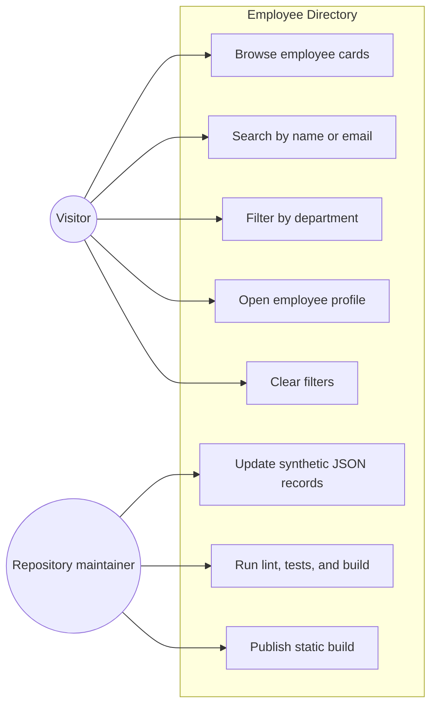
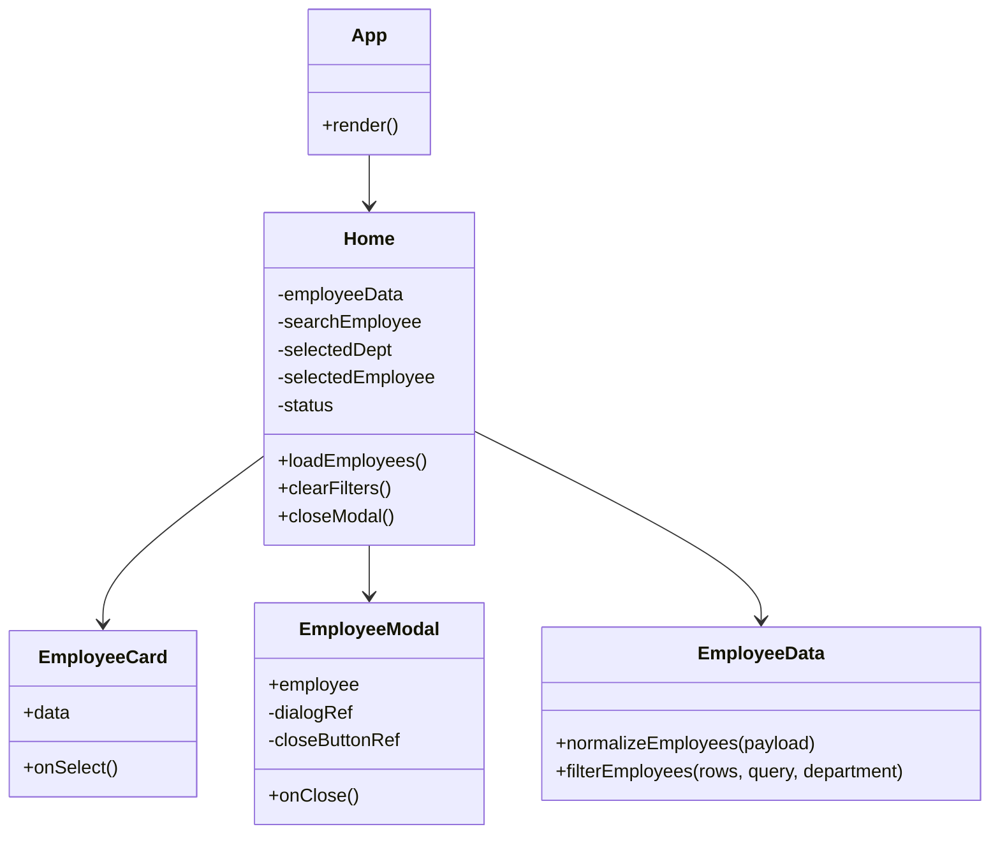
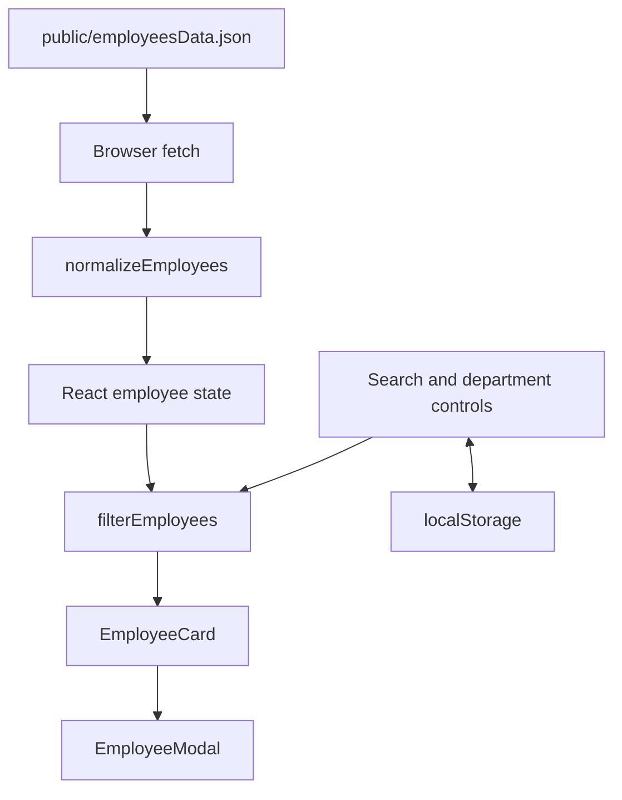
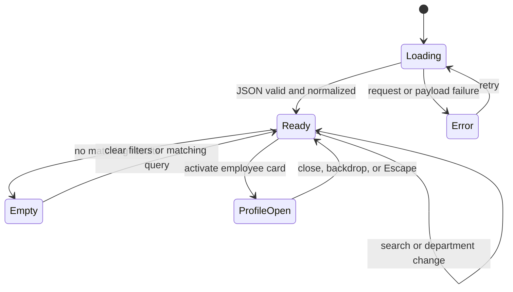
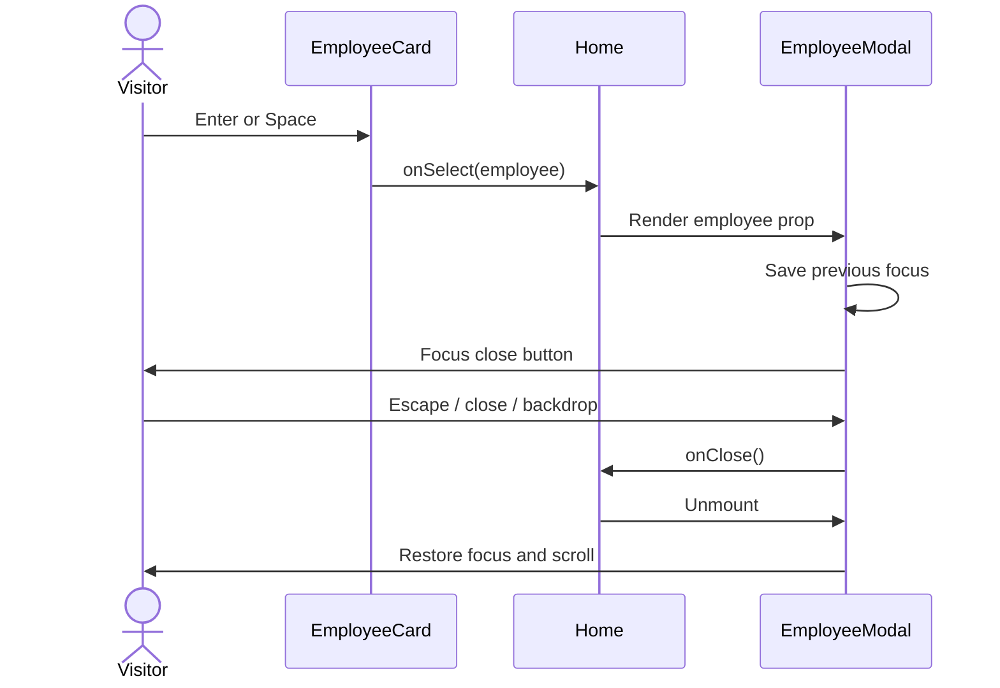
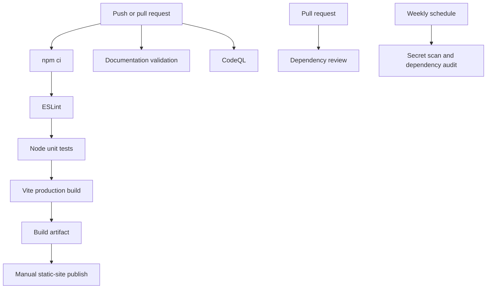
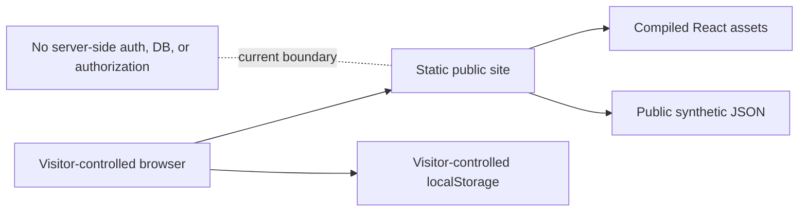

# 📐 UML and application diagrams

This page collects project-specific diagrams. Every diagram reflects the current static frontend; absent backend concepts are intentionally not modelled as if they existed.

## 1. System context

## 2. Use-case diagram

## 3. Component hierarchy / class-style view

## 4. Data-flow diagram

## 5. Application state diagram

## 6. Profile-dialog sequence

## 7. CI and release flow

## 8. Security trust boundary

## Not applicable
No entity-relationship diagram, login/session sequence, authorization flow, API request pipeline, database class model, or server-side backup diagram is included because the current repository does not implement those systems.
