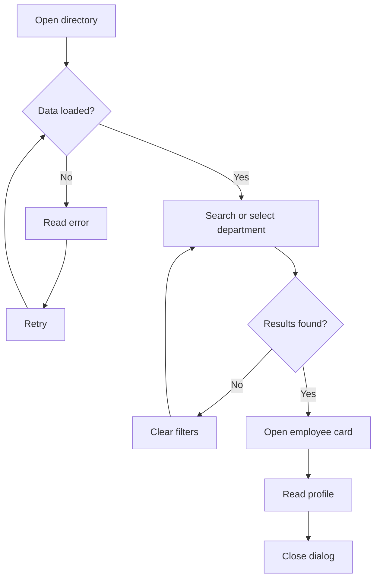

# 🧭 User journeys

## Journey A: Find a person
1. Open the root route.
2. Wait for the employee list to load.
3. Enter a name or email fragment.
4. Review the result count and matching cards.
5. Activate the person's card.
6. Read the available profile fields.
7. Close the dialog and continue browsing.

## Journey B: Explore a department
1. Open the directory.
2. Select a department label.
3. Scan the remaining cards.
4. Clear filters to return to the full sample dataset.

## Journey C: Recover from unavailable data
1. Open the directory while the JSON asset cannot be reached.
2. Read the error message.
3. Restore the asset or connection.
4. Activate Try again.
5. Confirm the results appear.

## Journey diagram

Journeys are browser interactions only. There are no sign-in, employee editing, approval, or administrative journeys.
